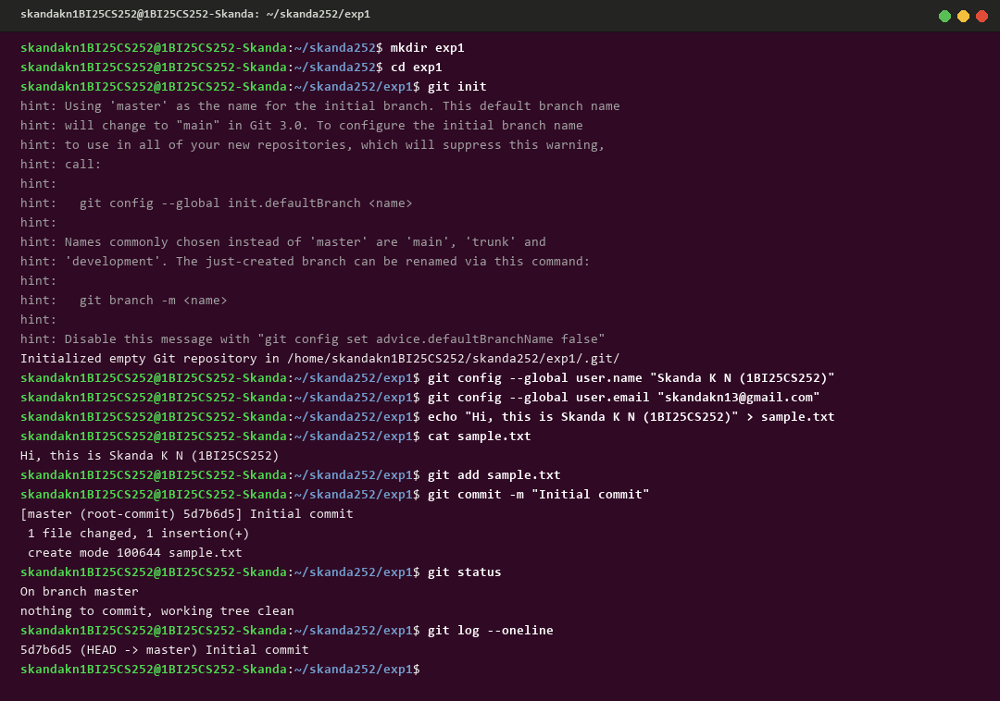
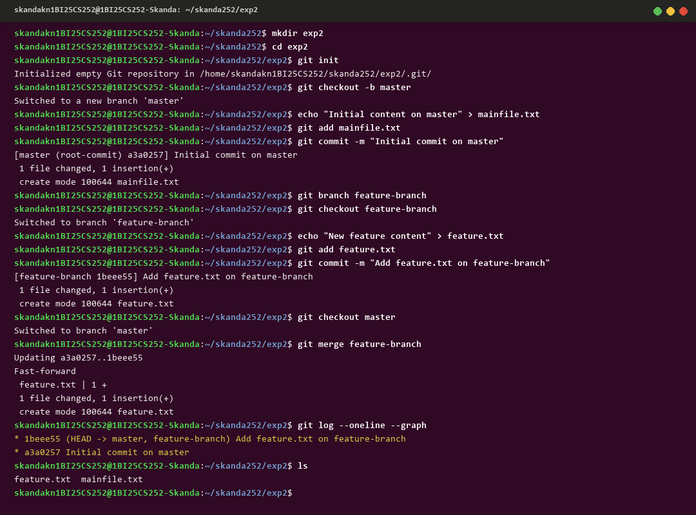
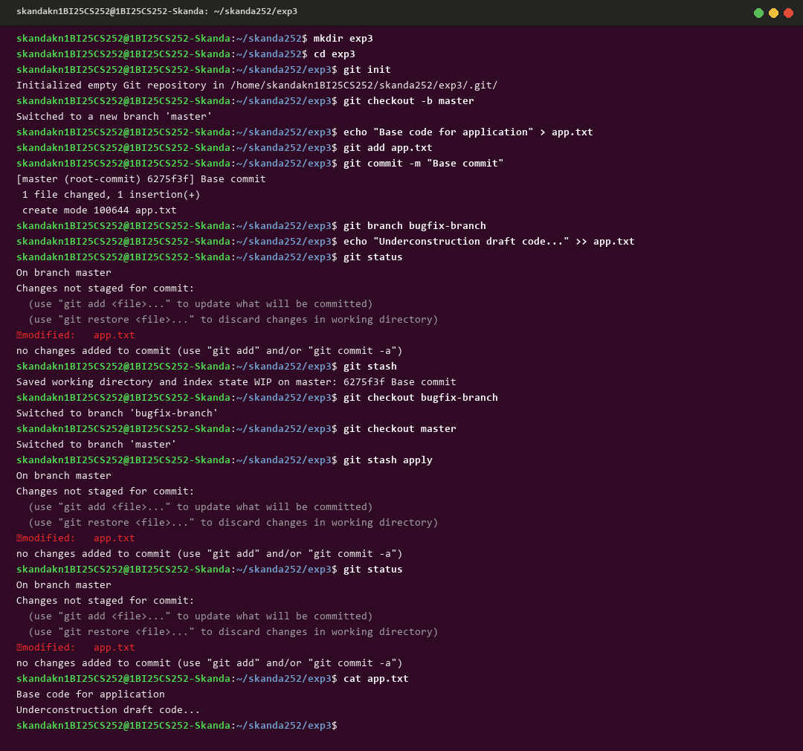
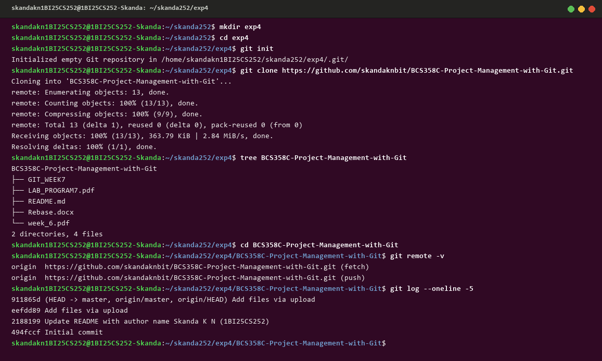
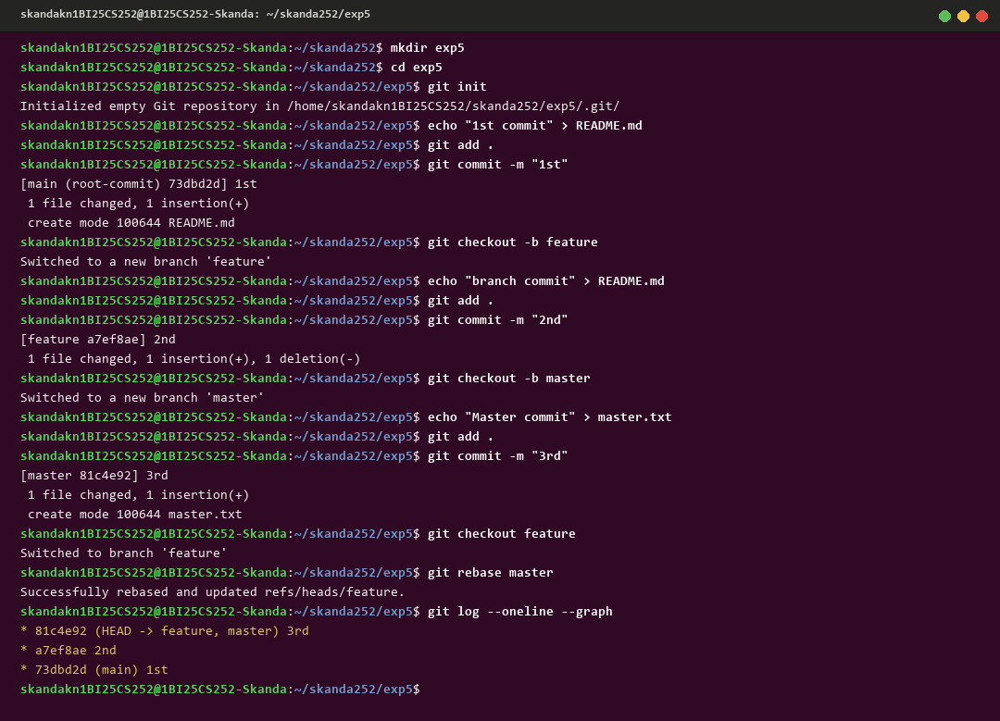
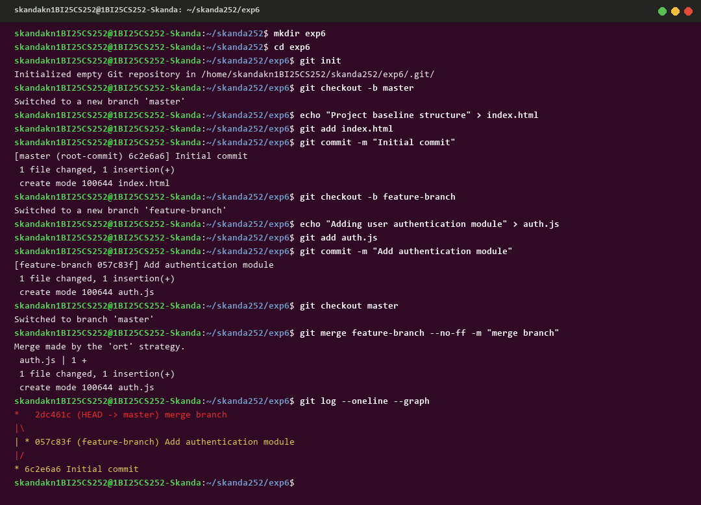
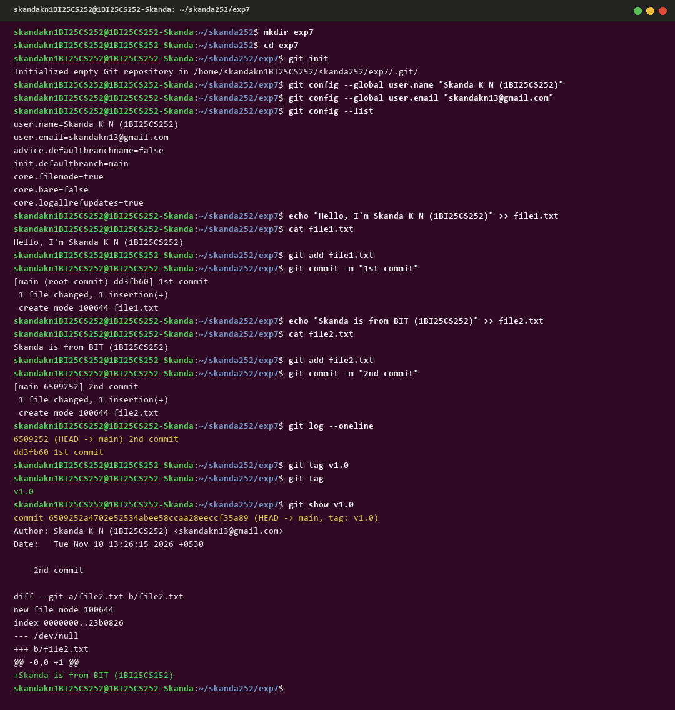

# BANGALORE INSTITUTE OF TECHNOLOGY (BIT)
### K.R. Road, V.V. Puram, Bengaluru - 560004
### **Department of Computer Science & Engineering**
#### **Course: Project Management with GIT (BCSL307A / BCS358C)**

---

### **Student Credentials**
* **Student Name:** Skanda K N
* **USN:** 1BI25CS252
* **Terminal Identifier:** `skandakn1BI25CS252@1BI25CS252-Skanda`
* **Semester & Section:** 3rd Semester B.E. (CSE)
* **GitHub Profile:** [@skandaknbit](https://github.com/skandaknbit)
* **Repository Link:** [https://github.com/skandaknbit/BCS358C-Project-Management-with-Git](https://github.com/skandaknbit/BCS358C-Project-Management-with-Git)

---

## **INDEX OF EXPERIMENTS**

| Exp No. | Experiment Title | Directory | Terminal Screenshot |
|:---:|:---|:---:|:---:|
| **1** | Setting Up and Basic Commands | `exp1/` | [exp1.png](screenshots/exp1.png) |
| **2** | Creating and Managing Branches | `exp2/` | [exp2.png](screenshots/exp2.png) |
| **3** | Stashing Changes | `exp3/` | [exp3.png](screenshots/exp3.png) |
| **4** | Collaboration & Remote Repositories (Cloning) | `exp4/` | [exp4.png](screenshots/exp4.png) |
| **5** | Fetching and Rebasing | `exp5/` | [exp5.png](screenshots/exp5.png) |
| **6** | Collaboration & Merging with Custom Commit Messages | `exp6/` | [exp6.png](screenshots/exp6.png) |
| **7** | Git Tags and Releases | `exp7/` | [exp7.png](screenshots/exp7.png) |

---

## **Experiment 1. Setting Up and Basic Commands**

### **Aim / Problem Statement:**
Initialize a new Git repository in a dedicated directory. Create a new file, add it to the staging area, and commit the changes with an appropriate commit message.

### **Theoretical Concept:**
Git is a distributed version control system that records changes to a file or set of files over time. In Git:
* `git init` creates the local `.git` subdirectory containing metadata and object databases.
* `git config` sets the committer identity used across all commits.
* The **Working Directory** holds untracked or modified files on disk.
* The **Staging Area (Index)** buffers snapshots before finalizing them into permanent history via `git commit`.

---

### **Step-by-Step Procedure:**

#### **Step 1: Create a separate directory for the experiment**
$ mkdir exp1

#### **Step 2: Navigate into the project folder**
$ cd exp1

#### **Step 3: Initialize the Git repository**
$ git init

#### **Step 4: Configure user credentials globally**
$ git config --global user.name "Skanda K N (1BI25CS252)"
$ git config --global user.email "skandakn13@gmail.com"

#### **Step 5: Create a new sample file**
$ echo "Hi, this is Skanda K N (1BI25CS252)" > sample.txt

#### **Step 6: Display file contents to verify creation**
$ cat sample.txt

#### **Step 7: Add the file to the staging area (Index)**
$ git add sample.txt

#### **Step 8: Commit the staged file with an intention message**
$ git commit -m "Initial commit"

#### **Step 9: Verify the working tree status**
$ git status

#### **Step 10: View the chronological commit log in compressed single-line format**
$ git log --oneline

---

### **Terminal Output:**
```text
skandakn1BI25CS252@1BI25CS252-Skanda:~/skanda252$ mkdir exp1
skandakn1BI25CS252@1BI25CS252-Skanda:~/skanda252$ cd exp1
skandakn1BI25CS252@1BI25CS252-Skanda:~/skanda252/exp1$ git init
Initialized empty Git repository in /home/skandakn1BI25CS252/skanda252/exp1/.git/
skandakn1BI25CS252@1BI25CS252-Skanda:~/skanda252/exp1$ git config --global user.name "Skanda K N (1BI25CS252)"
skandakn1BI25CS252@1BI25CS252-Skanda:~/skanda252/exp1$ git config --global user.email "skandakn13@gmail.com"
skandakn1BI25CS252@1BI25CS252-Skanda:~/skanda252/exp1$ echo "Hi, this is Skanda K N (1BI25CS252)" > sample.txt
skandakn1BI25CS252@1BI25CS252-Skanda:~/skanda252/exp1$ cat sample.txt
Hi, this is Skanda K N (1BI25CS252)
skandakn1BI25CS252@1BI25CS252-Skanda:~/skanda252/exp1$ git add sample.txt
skandakn1BI25CS252@1BI25CS252-Skanda:~/skanda252/exp1$ git commit -m "Initial commit"
[master (root-commit) 5d7b6d5] Initial commit
 1 file changed, 1 insertion(+)
 create mode 100644 sample.txt
skandakn1BI25CS252@1BI25CS252-Skanda:~/skanda252/exp1$ git status
On branch master
nothing to commit, working tree clean
skandakn1BI25CS252@1BI25CS252-Skanda:~/skanda252/exp1$ git log --oneline
5d7b6d5 (HEAD -> master) Initial commit
```

### **Execution Screenshot:**
<div align="center">
  
</div>

---

## **Experiment 2. Creating and Managing Branches**

### **Aim / Problem Statement:**
Create a new branch named "feature-branch". Switch to the "master/main" branch. Merge the "feature-branch" into "master/main".

### **Theoretical Concept:**
Branches in Git are lightweight pointers to specific commits. Creating a branch allows developers to isolate experimental features or bug fixes without impacting the stable production codebase (`master`/`main`). When feature development is complete and verified, merging integrates the isolated branch commits back into the target base branch.

---

### **Step-by-Step Procedure:**

#### **Step 1: Create a separate directory for the experiment**
$ mkdir exp2

#### **Step 2: Navigate into the directory**
$ cd exp2

#### **Step 3: Initialize the Git repository**
$ git init

#### **Step 4: Switch to or establish the master branch**
$ git checkout -b master

#### **Step 5: Create a baseline file on master**
$ echo "Initial content on master" > mainfile.txt

#### **Step 6: Stage and commit the baseline file**
$ git add mainfile.txt
$ git commit -m "Initial commit on master"

#### **Step 7: Create a new branch named 'feature-branch'**
$ git branch feature-branch

#### **Step 8: Switch to the newly created feature-branch**
$ git checkout feature-branch

#### **Step 9: Create and write new feature content**
$ echo "New feature content" > feature.txt

#### **Step 10: Stage and commit the feature file on feature-branch**
$ git add feature.txt
$ git commit -m "Add feature.txt on feature-branch"

#### **Step 11: Switch back to the master branch**
$ git checkout master

#### **Step 12: Merge feature-branch into master**
$ git merge feature-branch

#### **Step 13: View the commit graph and verify files**
$ git log --oneline --graph
$ ls

---

### **Terminal Output:**
```text
skandakn1BI25CS252@1BI25CS252-Skanda:~/skanda252$ mkdir exp2
skandakn1BI25CS252@1BI25CS252-Skanda:~/skanda252$ cd exp2
skandakn1BI25CS252@1BI25CS252-Skanda:~/skanda252/exp2$ git init
Initialized empty Git repository in /home/skandakn1BI25CS252/skanda252/exp2/.git/
skandakn1BI25CS252@1BI25CS252-Skanda:~/skanda252/exp2$ git checkout -b master
Switched to a new branch 'master'
skandakn1BI25CS252@1BI25CS252-Skanda:~/skanda252/exp2$ echo "Initial content on master" > mainfile.txt
skandakn1BI25CS252@1BI25CS252-Skanda:~/skanda252/exp2$ git add mainfile.txt
skandakn1BI25CS252@1BI25CS252-Skanda:~/skanda252/exp2$ git commit -m "Initial commit on master"
[master (root-commit) a3a0257] Initial commit on master
 1 file changed, 1 insertion(+)
 create mode 100644 mainfile.txt
skandakn1BI25CS252@1BI25CS252-Skanda:~/skanda252/exp2$ git branch feature-branch
skandakn1BI25CS252@1BI25CS252-Skanda:~/skanda252/exp2$ git checkout feature-branch
Switched to branch 'feature-branch'
skandakn1BI25CS252@1BI25CS252-Skanda:~/skanda252/exp2$ echo "New feature content" > feature.txt
skandakn1BI25CS252@1BI25CS252-Skanda:~/skanda252/exp2$ git add feature.txt
skandakn1BI25CS252@1BI25CS252-Skanda:~/skanda252/exp2$ git commit -m "Add feature.txt on feature-branch"
[feature-branch 1beee55] Add feature.txt on feature-branch
 1 file changed, 1 insertion(+)
 create mode 100644 feature.txt
skandakn1BI25CS252@1BI25CS252-Skanda:~/skanda252/exp2$ git checkout master
Switched to branch 'master'
skandakn1BI25CS252@1BI25CS252-Skanda:~/skanda252/exp2$ git merge feature-branch
Updating a3a0257..1beee55
Fast-forward
 feature.txt | 1 +
 1 file changed, 1 insertion(+)
 create mode 100644 feature.txt
skandakn1BI25CS252@1BI25CS252-Skanda:~/skanda252/exp2$ git log --oneline --graph
* 1beee55 (HEAD -> master, feature-branch) Add feature.txt on feature-branch
* a3a0257 Initial commit on master
skandakn1BI25CS252@1BI25CS252-Skanda:~/skanda252/exp2$ ls
feature.txt  mainfile.txt
```

### **Execution Screenshot:**
<div align="center">
  
</div>

---

## **Experiment 3. Stashing Changes**

### **Aim / Problem Statement:**
Write the commands to stash uncommitted modifications in the current branch, switch branches, switch back, and re-apply the stashed modifications.

### **Theoretical Concept:**
`git stash` temporarily shelves (or stashes) changes you've made to your working copy so you can work on something else, and then come back and re-apply them later on. This is essential when urgent hotfixes or task switches are needed before completing an in-progress feature.

---

### **Step-by-Step Procedure:**

#### **Step 1: Create a separate directory for the experiment**
$ mkdir exp3

#### **Step 2: Navigate into the directory**
$ cd exp3

#### **Step 3: Initialize the Git repository**
$ git init

#### **Step 4: Switch to master and make a base commit**
$ git checkout -b master
$ echo "Base code for application" > app.txt
$ git add app.txt
$ git commit -m "Base commit"

#### **Step 5: Create a secondary branch for hotfixes**
$ git branch bugfix-branch

#### **Step 6: Make uncommitted, experimental changes in the working directory**
$ echo "Underconstruction draft code..." >> app.txt

#### **Step 7: Check working tree status to observe dirty state**
$ git status

#### **Step 8: Stash uncommitted changes onto the stash stack**
$ git stash

#### **Step 9: Switch to the bugfix branch with a clean working tree**
$ git checkout bugfix-branch

#### **Step 10: Switch back to master**
$ git checkout master

#### **Step 11: Re-apply the stashed modifications**
$ git stash apply

#### **Step 12: Verify that modifications are restored**
$ git status
$ cat app.txt

---

### **Terminal Output:**
```text
skandakn1BI25CS252@1BI25CS252-Skanda:~/skanda252$ mkdir exp3
skandakn1BI25CS252@1BI25CS252-Skanda:~/skanda252$ cd exp3
skandakn1BI25CS252@1BI25CS252-Skanda:~/skanda252/exp3$ git init
Initialized empty Git repository in /home/skandakn1BI25CS252/skanda252/exp3/.git/
skandakn1BI25CS252@1BI25CS252-Skanda:~/skanda252/exp3$ git checkout -b master
Switched to a new branch 'master'
skandakn1BI25CS252@1BI25CS252-Skanda:~/skanda252/exp3$ echo "Base code for application" > app.txt
skandakn1BI25CS252@1BI25CS252-Skanda:~/skanda252/exp3$ git add app.txt
skandakn1BI25CS252@1BI25CS252-Skanda:~/skanda252/exp3$ git commit -m "Base commit"
[master (root-commit) 6275f3f] Base commit
 1 file changed, 1 insertion(+)
 create mode 100644 app.txt
skandakn1BI25CS252@1BI25CS252-Skanda:~/skanda252/exp3$ git branch bugfix-branch
skandakn1BI25CS252@1BI25CS252-Skanda:~/skanda252/exp3$ echo "Underconstruction draft code..." >> app.txt
skandakn1BI25CS252@1BI25CS252-Skanda:~/skanda252/exp3$ git status
On branch master
Changes not staged for commit:
	modified:   app.txt
no changes added to commit (use "git add" and/or "git commit -a")
skandakn1BI25CS252@1BI25CS252-Skanda:~/skanda252/exp3$ git stash
Saved working directory and index state WIP on master: 6275f3f Base commit
skandakn1BI25CS252@1BI25CS252-Skanda:~/skanda252/exp3$ git checkout bugfix-branch
Switched to branch 'bugfix-branch'
skandakn1BI25CS252@1BI25CS252-Skanda:~/skanda252/exp3$ git checkout master
Switched to branch 'master'
skandakn1BI25CS252@1BI25CS252-Skanda:~/skanda252/exp3$ git stash apply
On branch master
Changes not staged for commit:
	modified:   app.txt
no changes added to commit (use "git add" and/or "git commit -a")
skandakn1BI25CS252@1BI25CS252-Skanda:~/skanda252/exp3$ cat app.txt
Base code for application
Underconstruction draft code...
```

### **Execution Screenshot:**
<div align="center">
  
</div>

---

## **Experiment 4. Collaboration and Remote Repositories (Cloning)**

### **Aim / Problem Statement:**
Clone an existing remote Git repository from GitHub to your local machine, inspect remote bindings, and examine the historical commit log.

### **Theoretical Concept:**
`git clone` downloads an existing remote Git repository onto the local machine. It automatically sets up remote-tracking branches (`origin/master`) and creates an `origin` remote pointing back to the cloned URL.

---

### **Step-by-Step Procedure:**

#### **Step 1: Create a separate directory for the experiment**
$ mkdir exp4

#### **Step 2: Navigate into the directory**
$ cd exp4

#### **Step 3: Initialize the Git repository**
$ git init

#### **Step 4: Clone the remote repository from GitHub**
$ git clone https://github.com/skandaknbit/BCS358C-Project-Management-with-Git.git

#### **Step 5: Inspect directory structure of the cloned repository**
$ tree BCS358C-Project-Management-with-Git

#### **Step 6: Enter the cloned project folder**
$ cd BCS358C-Project-Management-with-Git

#### **Step 7: Verify remote repository connection and URLs**
$ git remote -v

#### **Step 8: View the last 5 commits from the cloned history**
$ git log --oneline -5

---

### **Terminal Output:**
```text
skandakn1BI25CS252@1BI25CS252-Skanda:~/skanda252$ mkdir exp4
skandakn1BI25CS252@1BI25CS252-Skanda:~/skanda252$ cd exp4
skandakn1BI25CS252@1BI25CS252-Skanda:~/skanda252/exp4$ git init
Initialized empty Git repository in /home/skandakn1BI25CS252/skanda252/exp4/.git/
skandakn1BI25CS252@1BI25CS252-Skanda:~/skanda252/exp4$ git clone https://github.com/skandaknbit/BCS358C-Project-Management-with-Git.git
Cloning into 'BCS358C-Project-Management-with-Git'...
remote: Enumerating objects: 13, done.
remote: Counting objects: 100% (13/13), done.
remote: Compressing objects: 100% (9/9), done.
remote: Total 13 (delta 1), reused 0 (delta 0), pack-reused 0 (from 0)
Receiving objects: 100% (13/13), 363.79 KiB | 2.84 MiB/s, done.
Resolving deltas: 100% (1/1), done.
skandakn1BI25CS252@1BI25CS252-Skanda:~/skanda252/exp4$ tree BCS358C-Project-Management-with-Git
BCS358C-Project-Management-with-Git
├── GIT_WEEK7
├── LAB_PROGRAM7.pdf
├── README.md
├── Rebase.docx
└── week_6.pdf
2 directories, 4 files
skandakn1BI25CS252@1BI25CS252-Skanda:~/skanda252/exp4$ cd BCS358C-Project-Management-with-Git
skandakn1BI25CS252@1BI25CS252-Skanda:~/skanda252/exp4/BCS358C-Project-Management-with-Git$ git remote -v
origin  https://github.com/skandaknbit/BCS358C-Project-Management-with-Git.git (fetch)
origin  https://github.com/skandaknbit/BCS358C-Project-Management-with-Git.git (push)
skandakn1BI25CS252@1BI25CS252-Skanda:~/skanda252/exp4/BCS358C-Project-Management-with-Git$ git log --oneline -5
911865d (HEAD -> master, origin/master, origin/HEAD) Add files via upload
eefdd89 Add files via upload
2188199 Update README with author name Skanda K N (1BI25CS252)
494fccf Initial commit
```

### **Execution Screenshot:**
<div align="center">
  
</div>

---

## **Experiment 5. Fetching and Rebasing**

### **Aim / Problem Statement:**
Fetch the latest changes from the remote repository and rebase your local branch onto the updated base branch to maintain a clean, linear commit history.

### **Theoretical Concept:**
* `git fetch` retrieves commits, references, and files from a remote repository without altering local working branches.
* `git rebase` reapplies commits from one branch on top of another. Unlike merging (which introduces a non-linear merge commit), rebasing produces a completely streamlined, linear timeline of commits.

---

### **Step-by-Step Procedure:**

#### **Step 1: Create a separate directory for the experiment**
$ mkdir exp5

#### **Step 2: Navigate into the directory**
$ cd exp5

#### **Step 3: Initialize the Git repository**
$ git init

#### **Step 4: Create root commit on baseline branch**
$ echo "1st commit" > README.md
$ git add .
$ git commit -m "1st"

#### **Step 5: Create and checkout feature branch**
$ git checkout -b feature
$ echo "branch commit" > README.md
$ git add .
$ git commit -m "2nd"

#### **Step 6: Switch to master and make an independent commit**
$ git checkout -b master
$ echo "Master commit" > master.txt
$ git add .
$ git commit -m "3rd"

#### **Step 7: Switch back to feature branch**
$ git checkout feature

#### **Step 8: Rebase feature branch on top of master**
$ git rebase master

#### **Step 9: Inspect the linear commit graph**
$ git log --oneline --graph

---

### **Terminal Output:**
```text
skandakn1BI25CS252@1BI25CS252-Skanda:~/skanda252$ mkdir exp5
skandakn1BI25CS252@1BI25CS252-Skanda:~/skanda252$ cd exp5
skandakn1BI25CS252@1BI25CS252-Skanda:~/skanda252/exp5$ git init
Initialized empty Git repository in /home/skandakn1BI25CS252/skanda252/exp5/.git/
skandakn1BI25CS252@1BI25CS252-Skanda:~/skanda252/exp5$ echo "1st commit" > README.md
skandakn1BI25CS252@1BI25CS252-Skanda:~/skanda252/exp5$ git add .
skandakn1BI25CS252@1BI25CS252-Skanda:~/skanda252/exp5$ git commit -m "1st"
[main (root-commit) 73dbd2d] 1st
 1 file changed, 1 insertion(+)
 create mode 100644 README.md
skandakn1BI25CS252@1BI25CS252-Skanda:~/skanda252/exp5$ git checkout -b feature
Switched to a new branch 'feature'
skandakn1BI25CS252@1BI25CS252-Skanda:~/skanda252/exp5$ echo "branch commit" > README.md
skandakn1BI25CS252@1BI25CS252-Skanda:~/skanda252/exp5$ git add .
skandakn1BI25CS252@1BI25CS252-Skanda:~/skanda252/exp5$ git commit -m "2nd"
[feature a7ef8ae] 2nd
 1 file changed, 1 insertion(+), 1 deletion(-)
skandakn1BI25CS252@1BI25CS252-Skanda:~/skanda252/exp5$ git checkout -b master
Switched to a new branch 'master'
skandakn1BI25CS252@1BI25CS252-Skanda:~/skanda252/exp5$ echo "Master commit" > master.txt
skandakn1BI25CS252@1BI25CS252-Skanda:~/skanda252/exp5$ git add .
skandakn1BI25CS252@1BI25CS252-Skanda:~/skanda252/exp5$ git commit -m "3rd"
[master 81c4e92] 3rd
 1 file changed, 1 insertion(+)
 create mode 100644 master.txt
skandakn1BI25CS252@1BI25CS252-Skanda:~/skanda252/exp5$ git checkout feature
Switched to branch 'feature'
skandakn1BI25CS252@1BI25CS252-Skanda:~/skanda252/exp5$ git rebase master
Successfully rebased and updated refs/heads/feature.
skandakn1BI25CS252@1BI25CS252-Skanda:~/skanda252/exp5$ git log --oneline --graph
* 81c4e92 (HEAD -> feature, master) 3rd
* a7ef8ae 2nd
* 73dbd2d (main) 1st
```

### **Execution Screenshot:**
<div align="center">
  
</div>

---

## **Experiment 6. Collaboration and Merging with Custom Commit Messages**

### **Aim / Problem Statement:**
Write the command to merge "feature-branch" into "master" while providing an informative custom commit message for the merge.

### **Theoretical Concept:**
By default, Git auto-generates a generic message such as `Merge branch 'feature-branch'`. Supplying the `--no-ff` flag forces Git to create an explicit merge commit with its own SHA hash, and `-m "<message>"` allows engineers to provide rigorous documentation for compliance and team auditing.

---

### **Step-by-Step Procedure:**

#### **Step 1: Create a separate directory for the experiment**
$ mkdir exp6

#### **Step 2: Navigate into the directory**
$ cd exp6

#### **Step 3: Initialize the Git repository**
$ git init

#### **Step 4: Switch to master and create a project baseline**
$ git checkout -b master
$ echo "Project baseline structure" > index.html
$ git add index.html
$ git commit -m "Initial commit"

#### **Step 5: Create and checkout feature-branch**
$ git checkout -b feature-branch

#### **Step 6: Develop authentication module on feature branch**
$ echo "Adding user authentication module" > auth.js
$ git add auth.js
$ git commit -m "Add authentication module"

#### **Step 7: Switch back to master branch**
$ git checkout master

#### **Step 8: Perform non-fast-forward merge with a custom message**
$ git merge feature-branch --no-ff -m "merge branch"

#### **Step 9: View the commit graph showing the explicit merge node**
$ git log --oneline --graph

---

### **Terminal Output:**
```text
skandakn1BI25CS252@1BI25CS252-Skanda:~/skanda252$ mkdir exp6
skandakn1BI25CS252@1BI25CS252-Skanda:~/skanda252$ cd exp6
skandakn1BI25CS252@1BI25CS252-Skanda:~/skanda252/exp6$ git init
Initialized empty Git repository in /home/skandakn1BI25CS252/skanda252/exp6/.git/
skandakn1BI25CS252@1BI25CS252-Skanda:~/skanda252/exp6$ git checkout -b master
Switched to a new branch 'master'
skandakn1BI25CS252@1BI25CS252-Skanda:~/skanda252/exp6$ echo "Project baseline structure" > index.html
skandakn1BI25CS252@1BI25CS252-Skanda:~/skanda252/exp6$ git add index.html
skandakn1BI25CS252@1BI25CS252-Skanda:~/skanda252/exp6$ git commit -m "Initial commit"
[master (root-commit) 6c2e6a6] Initial commit
 1 file changed, 1 insertion(+)
 create mode 100644 index.html
skandakn1BI25CS252@1BI25CS252-Skanda:~/skanda252/exp6$ git checkout -b feature-branch
Switched to a new branch 'feature-branch'
skandakn1BI25CS252@1BI25CS252-Skanda:~/skanda252/exp6$ echo "Adding user authentication module" > auth.js
skandakn1BI25CS252@1BI25CS252-Skanda:~/skanda252/exp6$ git add auth.js
skandakn1BI25CS252@1BI25CS252-Skanda:~/skanda252/exp6$ git commit -m "Add authentication module"
[feature-branch 057c83f] Add authentication module
 1 file changed, 1 insertion(+)
 create mode 100644 auth.js
skandakn1BI25CS252@1BI25CS252-Skanda:~/skanda252/exp6$ git checkout master
Switched to branch 'master'
skandakn1BI25CS252@1BI25CS252-Skanda:~/skanda252/exp6$ git merge feature-branch --no-ff -m "merge branch"
Merge made by the 'ort' strategy.
 auth.js | 1 +
 1 file changed, 1 insertion(+)
 create mode 100644 auth.js
skandakn1BI25CS252@1BI25CS252-Skanda:~/skanda252/exp6$ git log --oneline --graph
*   2dc461c (HEAD -> master) merge branch
|\  
| * 057c83f (feature-branch) Add authentication module
|/  
* 6c2e6a6 Initial commit
```

### **Execution Screenshot:**
<div align="center">
  
</div>

---

## **Experiment 7. Git Tags and Releases**

### **Aim / Problem Statement:**
Write the command to create a lightweight Git tag named "v1.0" for a commit in your local repository.

### **Theoretical Concept:**
A Git Tag is an immutable reference used to mark a specific point in a repository's history, typically release milestones (e.g., `v1.0`, `v2.0`).
* **Lightweight Tag:** A simple pointer to a specific commit. Does not contain author metadata or separate messages.
  * *Syntax:* `git tag v1.0`
* **Annotated Tag:** Stored as full objects in the Git database containing tagger name, email, date, and verification message.
  * *Syntax:* `git tag -a v1.0 -m "Release v1.0"`

---

### **Step-by-Step Procedure (As per Official Lab Manual):**

#### **Step 1: Create a separate directory for the experiment**
$ mkdir exp7

#### **Step 2: Navigate into the directory**
$ cd exp7

#### **Step 3: Initialize the Git repository**
$ git init

#### **Step 4: Configure user credentials**
$ git config --global user.name "Skanda K N (1BI25CS252)"
$ git config --global user.email "skandakn13@gmail.com"

#### **Step 5: Verify configuration settings**
$ git config --list

#### **Step 6: Create the first file**
$ echo "Hello, I'm Skanda K N (1BI25CS252)" >> file1.txt
$ cat file1.txt

#### **Step 7: Add and commit the first file**
$ git add file1.txt
$ git commit -m "1st commit"

#### **Step 8: Create the second file**
$ echo "Skanda is from BIT (1BI25CS252)" >> file2.txt
$ cat file2.txt

#### **Step 9: Add and commit the second file**
$ git add file2.txt
$ git commit -m "2nd commit"

#### **Step 10: View the chronological commit log**
$ git log --oneline

#### **Step 11: Create a lightweight Git tag**
$ git tag v1.0

#### **Step 12: Verify the tag creation**
$ git tag

#### **Step 13: View the details of the tagged commit**
$ git show v1.0

#### **Step 14: Connect the local repository to GitHub**
$ git remote add origin https://github.com/skandaknbit/trial.git

#### **Step 15: Push commits and release tags to GitHub**
$ git branch -M main
$ git push -u origin main
$ git push origin v1.0

---

### **Terminal Output:**
```text
skandakn1BI25CS252@1BI25CS252-Skanda:~/skanda252$ mkdir exp7
skandakn1BI25CS252@1BI25CS252-Skanda:~/skanda252$ cd exp7
skandakn1BI25CS252@1BI25CS252-Skanda:~/skanda252/exp7$ git init
Initialized empty Git repository in /home/skandakn1BI25CS252/skanda252/exp7/.git/
skandakn1BI25CS252@1BI25CS252-Skanda:~/skanda252/exp7$ git config --global user.name "Skanda K N (1BI25CS252)"
skandakn1BI25CS252@1BI25CS252-Skanda:~/skanda252/exp7$ git config --global user.email "skandakn13@gmail.com"
skandakn1BI25CS252@1BI25CS252-Skanda:~/skanda252/exp7$ git config --list
user.name=Skanda K N (1BI25CS252)
user.email=skandakn13@gmail.com
advice.defaultbranchname=false
init.defaultbranch=main
core.filemode=true
core.bare=false
core.logallrefupdates=true
skandakn1BI25CS252@1BI25CS252-Skanda:~/skanda252/exp7$ echo "Hello, I'm Skanda K N (1BI25CS252)" >> file1.txt
skandakn1BI25CS252@1BI25CS252-Skanda:~/skanda252/exp7$ cat file1.txt
Hello, I'm Skanda K N (1BI25CS252)
skandakn1BI25CS252@1BI25CS252-Skanda:~/skanda252/exp7$ git add file1.txt
skandakn1BI25CS252@1BI25CS252-Skanda:~/skanda252/exp7$ git commit -m "1st commit"
[main (root-commit) dd3fb60] 1st commit
 1 file changed, 1 insertion(+)
 create mode 100644 file1.txt
skandakn1BI25CS252@1BI25CS252-Skanda:~/skanda252/exp7$ echo "Skanda is from BIT (1BI25CS252)" >> file2.txt
skandakn1BI25CS252@1BI25CS252-Skanda:~/skanda252/exp7$ cat file2.txt
Skanda is from BIT (1BI25CS252)
skandakn1BI25CS252@1BI25CS252-Skanda:~/skanda252/exp7$ git add file2.txt
skandakn1BI25CS252@1BI25CS252-Skanda:~/skanda252/exp7$ git commit -m "2nd commit"
[main 6509252] 2nd commit
 1 file changed, 1 insertion(+)
 create mode 100644 file2.txt
skandakn1BI25CS252@1BI25CS252-Skanda:~/skanda252/exp7$ git log --oneline
6509252 (HEAD -> main) 2nd commit
dd3fb60 1st commit
skandakn1BI25CS252@1BI25CS252-Skanda:~/skanda252/exp7$ git tag v1.0
skandakn1BI25CS252@1BI25CS252-Skanda:~/skanda252/exp7$ git tag
v1.0
skandakn1BI25CS252@1BI25CS252-Skanda:~/skanda252/exp7$ git show v1.0
commit 6509252a4702e52534abee58ccaa28eeccf35a89 (HEAD -> main, tag: v1.0)
Author: Skanda K N (1BI25CS252) <skandakn13@gmail.com>
Date:   Tue Nov 10 13:26:15 2026 +0530

    2nd commit

diff --git a/file2.txt b/file2.txt
new file mode 100644
index 0000000..23b0826
--- /dev/null
+++ b/file2.txt
@@ -0,0 +1 @@
+Skanda is from BIT (1BI25CS252)
```

### **Execution Screenshot:**
<div align="center">
  
</div>

---

### **Git Tag Operations Reference Guide (Page 5 Table):**

| Action | Command | Description |
|:---|:---|:---|
| **List all tags** | `git tag` | Displays all available tags in the repository. |
| **Create a lightweight tag** | `git tag <tag-name>` | Creates a lightweight tag pointing to current commit. |
| **Create an annotated tag** | `git tag -a <tag-name> -m "<message>"` | Creates an annotated tag with message and tagger metadata. |
| **Create a tag for specific commit** | `git tag <tag-name> <commit-id>` | Creates a tag pointing to a specific commit SHA. |
| **Display tag details** | `git show <tag-name>` | Displays metadata and diff associated with the tag. |
| **Search tags** | `git tag -l "<pattern>"` | Lists tags matching the specified regex/glob pattern. |
| **Delete local tag** | `git tag -d <tag-name>` | Deletes the tag reference from local repository. |
| **Push specific tag to remote** | `git push origin <tag-name>` | Publishes the specified tag to GitHub remote. |
| **Push all tags to remote** | `git push origin --tags` | Pushes all local tags to GitHub remote. |
| **Fetch remote tags** | `git fetch --tags` | Downloads tags from the remote repository. |
| **Delete remote tag** | `git push origin --delete <tag-name>` | Removes the tag from remote GitHub server. |

---
*Prepared and Maintained by Skanda K N (USN: 1BI25CS252) | Department of CSE, BIT Bangalore*
