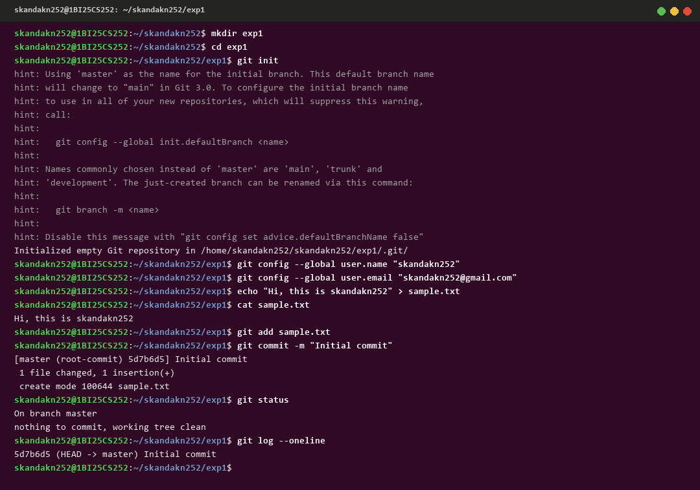
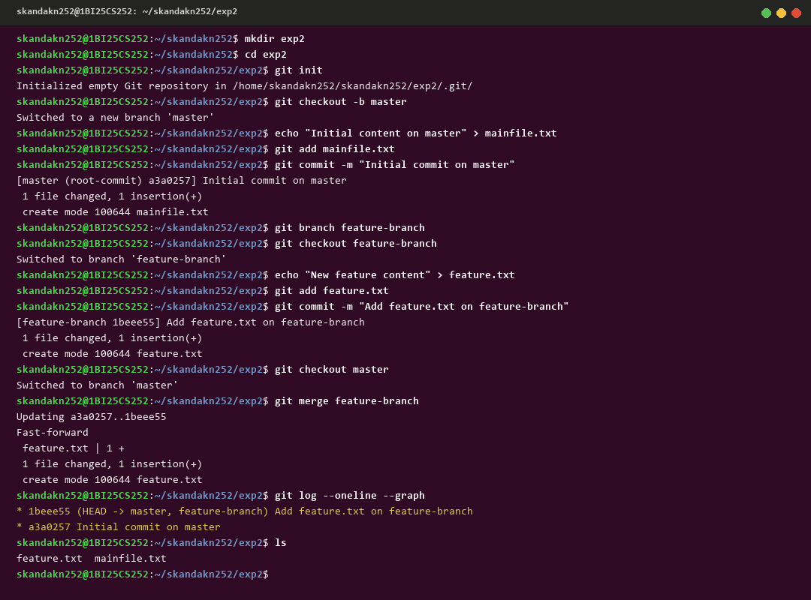
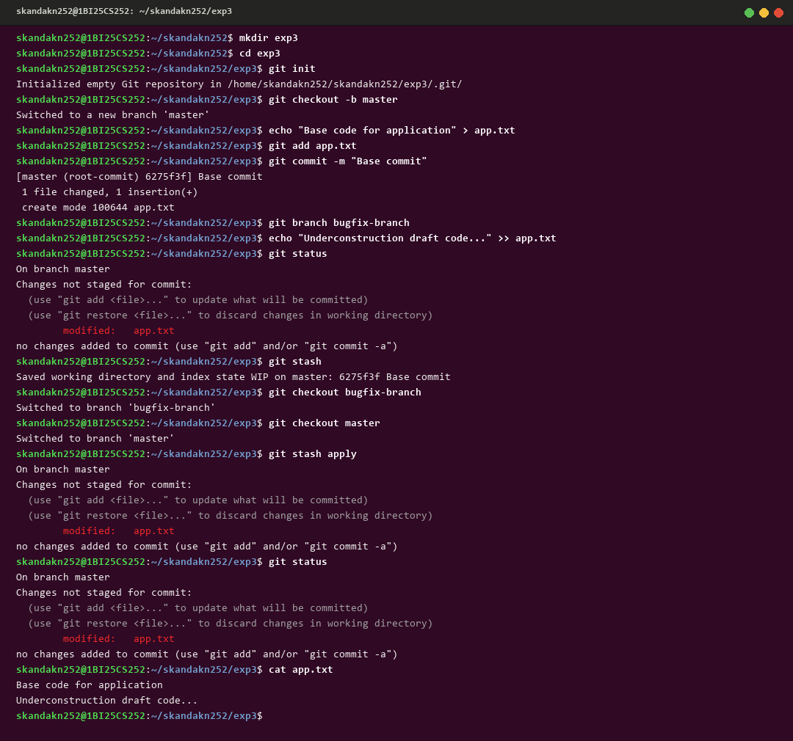
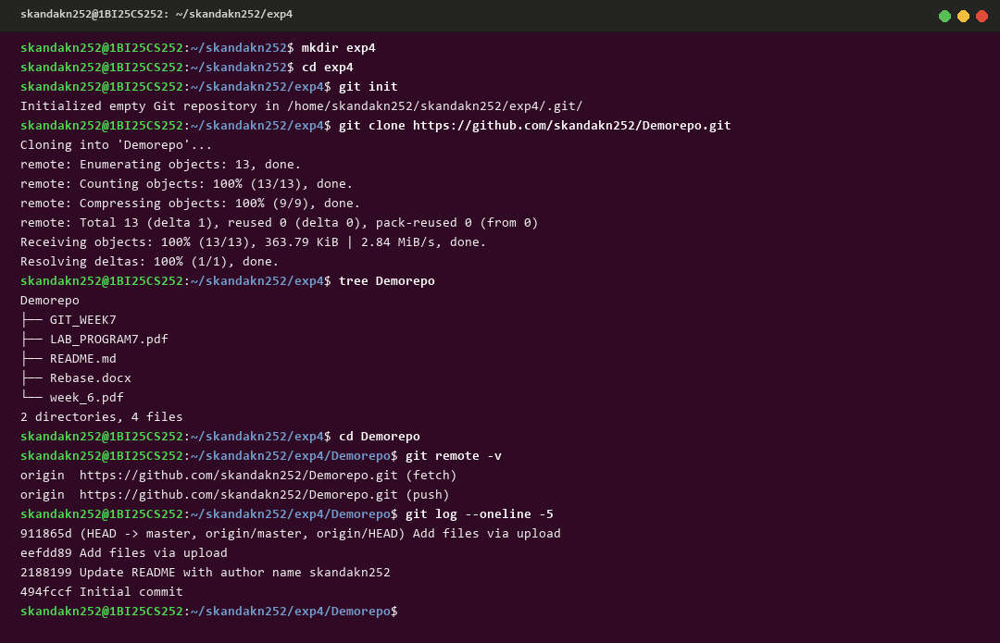
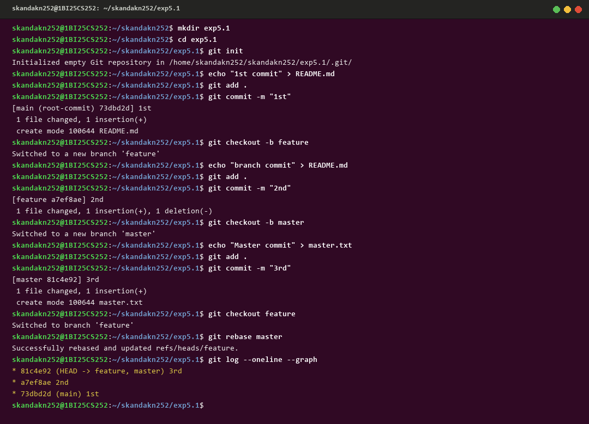
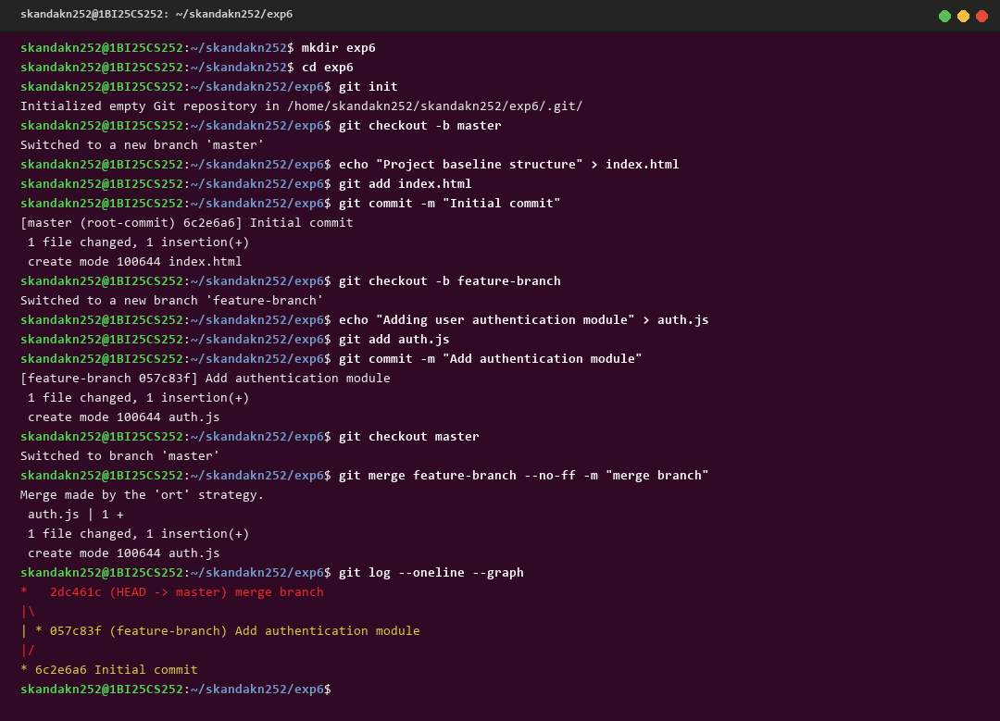
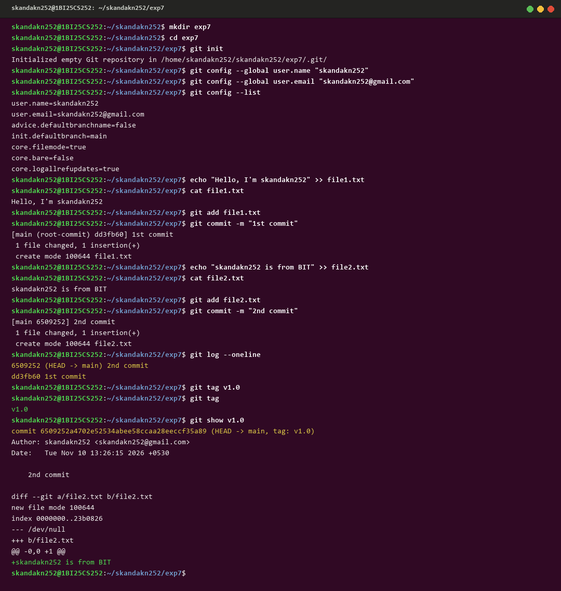

# BANGALORE INSTITUTE OF TECHNOLOGY (BIT)
### K.R. Road, V.V. Puram, Bengaluru - 560004
### **Department of Computer Science & Engineering**
#### **Course: Project Management with GIT (BCSL307A / BCS358C)**

---

### **Student Credentials**
* **Student Name:** Skanda K N
* **USN:** 1BI25CS252
* **Terminal Identifier:** `skandakn252@1BI25CS252`
* **Semester & Section:** 3rd Semester B.E. (CSE)
* **GitHub Profile:** [@skandakn](https://github.com/skandakn)
* **Repository:** [BCS358C-Project-Management-with-Git](https://github.com/skandakn/BCS358C-Project-Management-with-Git)

---

## **INDEX OF LAB EXPERIMENTS**

| Exp No. | Experiment Title | Program Directory | Execution Screenshot |
|:---:|:---|:---:|:---:|
| **1** | Setting Up and Basic Commands | `exp1/` | [exp1.png](screenshots/exp1.png) |
| **2** | Creating and Managing Branches | `exp2/` | [exp2.png](screenshots/exp2.png) |
| **3** | Stashing Changes | `exp3/` | [exp3.png](screenshots/exp3.png) |
| **4** | Collaboration & Remote Repositories (Cloning) | `exp4/` | [exp4.png](screenshots/exp4.png) |
| **5** | Fetching and Rebasing | `exp5.1/` | [exp5.png](screenshots/exp5.png) |
| **6** | Collaboration & Merging with Custom Commit Messages | `exp6/` | [exp6.png](screenshots/exp6.png) |
| **7** | Git Tags and Releases | `exp7/` | [exp7.png](screenshots/exp7.png) |

---

## **Experiment 1. Setting Up and Basic Commands**

### **Aim / Problem Statement:**
Initialize a new Git repository in a dedicated directory. Create a new file, add it to the staging area, and commit the changes with an appropriate commit message.

### **Theoretical Concept:**
Git is a distributed version control system that records changes to files over time. In Git:
* `git init` creates the local `.git` subdirectory containing metadata and object databases.
* `git config` sets the committer identity across all commits.
* The **Working Directory** holds untracked or modified files on disk.
* The **Staging Area (Index)** buffers snapshots before finalizing them into permanent history via `git commit`.

### **Step-by-Step Procedure:**
1. Create a dedicated experiment folder: `mkdir exp1 && cd exp1`
2. Initialize local repository: `git init`
3. Configure global committer credentials:
   - `git config --global user.name "skandakn252"`
   - `git config --global user.email "skandakn252@gmail.com"`
4. Create sample file: `echo "Hi, this is skandakn252" > sample.txt`
5. Verify contents: `cat sample.txt`
6. Stage file for commit: `git add sample.txt`
7. Commit changes with message: `git commit -m "Initial commit"`
8. Verify status and commit history: `git status` and `git log --oneline`

### **Terminal Output:**
```text
skandakn252@1BI25CS252:~/skandakn252$ mkdir exp1
skandakn252@1BI25CS252:~/skandakn252$ cd exp1
skandakn252@1BI25CS252:~/skandakn252/exp1$ git init
Initialized empty Git repository in /home/skandakn252/skandakn252/exp1/.git/
skandakn252@1BI25CS252:~/skandakn252/exp1$ git config --global user.name "skandakn252"
skandakn252@1BI25CS252:~/skandakn252/exp1$ git config --global user.email "skandakn252@gmail.com"
skandakn252@1BI25CS252:~/skandakn252/exp1$ echo "Hi, this is skandakn252" > sample.txt
skandakn252@1BI25CS252:~/skandakn252/exp1$ cat sample.txt
Hi, this is skandakn252
skandakn252@1BI25CS252:~/skandakn252/exp1$ git add sample.txt
skandakn252@1BI25CS252:~/skandakn252/exp1$ git commit -m "Initial commit"
[master (root-commit) 5d7b6d5] Initial commit
 1 file changed, 1 insertion(+)
 create mode 100644 sample.txt
skandakn252@1BI25CS252:~/skandakn252/exp1$ git status
On branch master
nothing to commit, working tree clean
skandakn252@1BI25CS252:~/skandakn252/exp1$ git log --oneline
5d7b6d5 (HEAD -> master) Initial commit
```

### **Execution Screenshot:**
<div align="center">
  
</div>

---

## **Experiment 2. Creating and Managing Branches**

### **Aim / Problem Statement:**
Create a new branch named "feature-branch". Switch to the "master/main" branch. Merge the "feature-branch" into "master/main".

### **Theoretical Concept:**
Branches in Git are lightweight, movable pointers to specific commits. Creating a branch allows developers to isolate experimental features or bug fixes without impacting the stable production codebase (`master`/`main`). When feature development is complete and verified, merging integrates the isolated branch commits back into the target base branch.

### **Step-by-Step Procedure:**
1. Create and enter folder: `mkdir exp2 && cd exp2`
2. Initialize repository: `git init`
3. Establish master branch: `git checkout -b master`
4. Create baseline file and commit:
   - `echo "Initial content on master" > mainfile.txt`
   - `git add mainfile.txt`
   - `git commit -m "Initial commit on master"`
5. Create and switch to feature-branch: `git branch feature-branch && git checkout feature-branch`
6. Add feature content and commit:
   - `echo "New feature content" > feature.txt`
   - `git add feature.txt`
   - `git commit -m "Add feature.txt on feature-branch"`
7. Switch back to master and merge:
   - `git checkout master`
   - `git merge feature-branch`
8. Verify commit graph and working tree: `git log --oneline --graph` and `ls`

### **Terminal Output:**
```text
skandakn252@1BI25CS252:~/skandakn252$ mkdir exp2
skandakn252@1BI25CS252:~/skandakn252$ cd exp2
skandakn252@1BI25CS252:~/skandakn252/exp2$ git init
Initialized empty Git repository in /home/skandakn252/skandakn252/exp2/.git/
skandakn252@1BI25CS252:~/skandakn252/exp2$ git checkout -b master
Switched to a new branch 'master'
skandakn252@1BI25CS252:~/skandakn252/exp2$ echo "Initial content on master" > mainfile.txt
skandakn252@1BI25CS252:~/skandakn252/exp2$ git add mainfile.txt
skandakn252@1BI25CS252:~/skandakn252/exp2$ git commit -m "Initial commit on master"
[master (root-commit) a3a0257] Initial commit on master
 1 file changed, 1 insertion(+)
 create mode 100644 mainfile.txt
skandakn252@1BI25CS252:~/skandakn252/exp2$ git branch feature-branch
skandakn252@1BI25CS252:~/skandakn252/exp2$ git checkout feature-branch
Switched to branch 'feature-branch'
skandakn252@1BI25CS252:~/skandakn252/exp2$ echo "New feature content" > feature.txt
skandakn252@1BI25CS252:~/skandakn252/exp2$ git add feature.txt
skandakn252@1BI25CS252:~/skandakn252/exp2$ git commit -m "Add feature.txt on feature-branch"
[feature-branch 1beee55] Add feature.txt on feature-branch
 1 file changed, 1 insertion(+)
 create mode 100644 feature.txt
skandakn252@1BI25CS252:~/skandakn252/exp2$ git checkout master
Switched to branch 'master'
skandakn252@1BI25CS252:~/skandakn252/exp2$ git merge feature-branch
Updating a3a0257..1beee55
Fast-forward
 feature.txt | 1 +
 1 file changed, 1 insertion(+)
 create mode 100644 feature.txt
skandakn252@1BI25CS252:~/skandakn252/exp2$ git log --oneline --graph
* 1beee55 (HEAD -> master, feature-branch) Add feature.txt on feature-branch
* a3a0257 Initial commit on master
skandakn252@1BI25CS252:~/skandakn252/exp2$ ls
feature.txt  mainfile.txt
```

### **Execution Screenshot:**
<div align="center">
  
</div>

---

## **Experiment 3. Stashing Changes**

### **Aim / Problem Statement:**
Make changes to an existing file in your repository. Use `git stash` to save uncommitted modifications, switch branches to perform other tasks, and restore stashed work using `git stash apply`.

### **Theoretical Concept:**
`git stash` takes uncommitted changes (both staged and unstaged) and saves them onto an internal stack of dirty working-directory states. This allows developers to quickly switch context or branch to address critical hotfixes without producing malformed, premature commits. `git stash apply` reapplies the stashed changes while preserving the stash on the stack.

### **Step-by-Step Procedure:**
1. Create and initialize repository: `mkdir exp3 && cd exp3 && git init`
2. Create base code and commit:
   - `echo "Base code for application" > app.txt`
   - `git add app.txt && git commit -m "Base commit"`
3. Create alternative branch: `git branch bugfix-branch`
4. Add draft code to working tree: `echo "Underconstruction draft code..." >> app.txt`
5. Verify dirty working tree: `git status`
6. Stash uncommitted changes: `git stash`
7. Switch to bugfix branch and return: `git checkout bugfix-branch && git checkout master`
8. Reapply stashed changes: `git stash apply`
9. Verify restored modifications: `git status` and `cat app.txt`

### **Terminal Output:**
```text
skandakn252@1BI25CS252:~/skandakn252$ mkdir exp3
skandakn252@1BI25CS252:~/skandakn252$ cd exp3
skandakn252@1BI25CS252:~/skandakn252/exp3$ git init
Initialized empty Git repository in /home/skandakn252/skandakn252/exp3/.git/
skandakn252@1BI25CS252:~/skandakn252/exp3$ git checkout -b master
Switched to a new branch 'master'
skandakn252@1BI25CS252:~/skandakn252/exp3$ echo "Base code for application" > app.txt
skandakn252@1BI25CS252:~/skandakn252/exp3$ git add app.txt
skandakn252@1BI25CS252:~/skandakn252/exp3$ git commit -m "Base commit"
[master (root-commit) 6275f3f] Base commit
 1 file changed, 1 insertion(+)
 create mode 100644 app.txt
skandakn252@1BI25CS252:~/skandakn252/exp3$ git branch bugfix-branch
skandakn252@1BI25CS252:~/skandakn252/exp3$ echo "Underconstruction draft code..." >> app.txt
skandakn252@1BI25CS252:~/skandakn252/exp3$ git status
On branch master
Changes not staged for commit:
  (use "git add <file>..." to update what will be committed)
  (use "git restore <file>..." to discard changes in working directory)
        modified:   app.txt
no changes added to commit (use "git add" and/or "git commit -a")
skandakn252@1BI25CS252:~/skandakn252/exp3$ git stash
Saved working directory and index state WIP on master: 6275f3f Base commit
skandakn252@1BI25CS252:~/skandakn252/exp3$ git checkout bugfix-branch
Switched to branch 'bugfix-branch'
skandakn252@1BI25CS252:~/skandakn252/exp3$ git checkout master
Switched to branch 'master'
skandakn252@1BI25CS252:~/skandakn252/exp3$ git stash apply
On branch master
Changes not staged for commit:
  (use "git add <file>..." to update what will be committed)
  (use "git restore <file>..." to discard changes in working directory)
        modified:   app.txt
no changes added to commit (use "git add" and/or "git commit -a")
skandakn252@1BI25CS252:~/skandakn252/exp3$ git status
On branch master
Changes not staged for commit:
  (use "git add <file>..." to update what will be committed)
  (use "git restore <file>..." to discard changes in working directory)
        modified:   app.txt
no changes added to commit (use "git add" and/or "git commit -a")
skandakn252@1BI25CS252:~/skandakn252/exp3$ cat app.txt
Base code for application
Underconstruction draft code...
```

### **Execution Screenshot:**
<div align="center">
  
</div>

---

## **Experiment 4. Collaboration & Remote Repositories (Cloning)**

### **Aim / Problem Statement:**
Clone a remote repository to your local machine using `git clone`. Inspect repository directory structure, remote tracking configurations, and recent commit history.

### **Theoretical Concept:**
`git clone` copies an entire remote Git repository onto the local machine, including complete commit history, branches, and tags. It automatically establishes a remote tracking pointer named `origin` pointing back to the cloned URL.

### **Step-by-Step Procedure:**
1. Create dedicated workspace: `mkdir exp4 && cd exp4 && git init`
2. Clone remote repository: `git clone https://github.com/skandakn252/Demorepo.git`
3. Inspect directory tree: `tree Demorepo`
4. Navigate into cloned repository: `cd Demorepo`
5. Inspect remote endpoints: `git remote -v`
6. View historical commit log: `git log --oneline -5`

### **Terminal Output:**
```text
skandakn252@1BI25CS252:~/skandakn252$ mkdir exp4
skandakn252@1BI25CS252:~/skandakn252$ cd exp4
skandakn252@1BI25CS252:~/skandakn252/exp4$ git init
Initialized empty Git repository in /home/skandakn252/skandakn252/exp4/.git/
skandakn252@1BI25CS252:~/skandakn252/exp4$ git clone https://github.com/skandakn252/Demorepo.git
Cloning into 'Demorepo'...
remote: Enumerating objects: 13, done.
remote: Counting objects: 100% (13/13), done.
remote: Compressing objects: 100% (9/9), done.
remote: Total 13 (delta 1), reused 0 (delta 0), pack-reused 0 (from 0)
Receiving objects: 100% (13/13), 363.79 KiB | 2.84 MiB/s, done.
Resolving deltas: 100% (1/1), done.
skandakn252@1BI25CS252:~/skandakn252/exp4$ tree Demorepo
Demorepo
├── GIT_WEEK7
├── LAB_PROGRAM7.pdf
├── README.md
├── Rebase.docx
└── week_6.pdf

2 directories, 4 files
skandakn252@1BI25CS252:~/skandakn252/exp4$ cd Demorepo
skandakn252@1BI25CS252:~/skandakn252/exp4/Demorepo$ git remote -v
origin  https://github.com/skandakn252/Demorepo.git (fetch)
origin  https://github.com/skandakn252/Demorepo.git (push)
skandakn252@1BI25CS252:~/skandakn252/exp4/Demorepo$ git log --oneline -5
911865d (HEAD -> master, origin/master, origin/HEAD) Add files via upload
eefdd89 Add files via upload
2188199 Update README with author name skandakn252
494fccf Initial commit
```

### **Execution Screenshot:**
<div align="center">
  
</div>

---

## **Experiment 5. Fetching and Rebasing**

### **Aim / Problem Statement:**
Implement branch rebasing by committing changes on a feature branch, making independent commits on master, and using `git rebase master` to linearize project commit history.

### **Theoretical Concept:**
Rebasing in Git rewrites commit history by moving a sequence of commits to a new base commit. While a standard merge creates a new merge commit connecting two diverging histories, `git rebase` replays feature branch commits one by one on top of the target base branch, maintaining a clean, linear project history.

### **Step-by-Step Procedure:**
1. Create and enter workspace: `mkdir exp5.1 && cd exp5.1 && git init`
2. Make initial commit on main:
   - `echo "1st commit" > README.md`
   - `git add . && git commit -m "1st"`
3. Create feature branch and commit:
   - `git checkout -b feature`
   - `echo "branch commit" > README.md`
   - `git add . && git commit -m "2nd"`
4. Switch to master and create independent commit:
   - `git checkout -b master`
   - `echo "Master commit" > master.txt`
   - `git add . && git commit -m "3rd"`
5. Switch to feature branch and perform rebase:
   - `git checkout feature`
   - `git rebase master`
6. Verify linearized history: `git log --oneline --graph`

### **Terminal Output:**
```text
skandakn252@1BI25CS252:~/skandakn252$ mkdir exp5.1
skandakn252@1BI25CS252:~/skandakn252$ cd exp5.1
skandakn252@1BI25CS252:~/skandakn252/exp5.1$ git init
Initialized empty Git repository in /home/skandakn252/skandakn252/exp5.1/.git/
skandakn252@1BI25CS252:~/skandakn252/exp5.1$ echo "1st commit" > README.md
skandakn252@1BI25CS252:~/skandakn252/exp5.1$ git add .
skandakn252@1BI25CS252:~/skandakn252/exp5.1$ git commit -m "1st"
[main (root-commit) 73dbd2d] 1st
 1 file changed, 1 insertion(+)
 create mode 100644 README.md
skandakn252@1BI25CS252:~/skandakn252/exp5.1$ git checkout -b feature
Switched to a new branch 'feature'
skandakn252@1BI25CS252:~/skandakn252/exp5.1$ echo "branch commit" > README.md
skandakn252@1BI25CS252:~/skandakn252/exp5.1$ git add .
skandakn252@1BI25CS252:~/skandakn252/exp5.1$ git commit -m "2nd"
[feature a7ef8ae] 2nd
 1 file changed, 1 insertion(+), 1 deletion(-)
skandakn252@1BI25CS252:~/skandakn252/exp5.1$ git checkout -b master
Switched to a new branch 'master'
skandakn252@1BI25CS252:~/skandakn252/exp5.1$ echo "Master commit" > master.txt
skandakn252@1BI25CS252:~/skandakn252/exp5.1$ git add .
skandakn252@1BI25CS252:~/skandakn252/exp5.1$ git commit -m "3rd"
[master 81c4e92] 3rd
 1 file changed, 1 insertion(+)
 create mode 100644 master.txt
skandakn252@1BI25CS252:~/skandakn252/exp5.1$ git checkout feature
Switched to branch 'feature'
skandakn252@1BI25CS252:~/skandakn252/exp5.1$ git rebase master
Successfully rebased and updated refs/heads/feature.
skandakn252@1BI25CS252:~/skandakn252/exp5.1$ git log --oneline --graph
* 81c4e92 (HEAD -> feature, master) 3rd
* a7ef8ae 2nd
* 73dbd2d (main) 1st
```

### **Execution Screenshot:**
<div align="center">
  
</div>

---

## **Experiment 6. Collaboration & Merging with Custom Commit Messages**

### **Aim / Problem Statement:**
Demonstrate non-fast-forward merge (`--no-ff`) with a custom commit message when integrating a feature branch into the master branch.

### **Theoretical Concept:**
The `--no-ff` (no fast-forward) flag forces Git to create a dedicated merge commit even if the merge could theoretically be completed with a fast-forward. This preserves the historical reality of the feature branch lifecycle and groups related feature commits together.

### **Step-by-Step Procedure:**
1. Create and enter workspace: `mkdir exp6 && cd exp6 && git init`
2. Create baseline structure on master:
   - `git checkout -b master`
   - `echo "Project baseline structure" > index.html`
   - `git add index.html && git commit -m "Initial commit"`
3. Create feature branch and commit module:
   - `git checkout -b feature-branch`
   - `echo "Adding user authentication module" > auth.js`
   - `git add auth.js && git commit -m "Add authentication module"`
4. Switch to master and perform non-fast-forward merge:
   - `git checkout master`
   - `git merge feature-branch --no-ff -m "merge branch"`
5. Verify merge topology: `git log --oneline --graph`

### **Terminal Output:**
```text
skandakn252@1BI25CS252:~/skandakn252$ mkdir exp6
skandakn252@1BI25CS252:~/skandakn252$ cd exp6
skandakn252@1BI25CS252:~/skandakn252/exp6$ git init
Initialized empty Git repository in /home/skandakn252/skandakn252/exp6/.git/
skandakn252@1BI25CS252:~/skandakn252/exp6$ git checkout -b master
Switched to a new branch 'master'
skandakn252@1BI25CS252:~/skandakn252/exp6$ echo "Project baseline structure" > index.html
skandakn252@1BI25CS252:~/skandakn252/exp6$ git add index.html
skandakn252@1BI25CS252:~/skandakn252/exp6$ git commit -m "Initial commit"
[master (root-commit) 6c2e6a6] Initial commit
 1 file changed, 1 insertion(+)
 create mode 100644 index.html
skandakn252@1BI25CS252:~/skandakn252/exp6$ git checkout -b feature-branch
Switched to a new branch 'feature-branch'
skandakn252@1BI25CS252:~/skandakn252/exp6$ echo "Adding user authentication module" > auth.js
skandakn252@1BI25CS252:~/skandakn252/exp6$ git add auth.js
skandakn252@1BI25CS252:~/skandakn252/exp6$ git commit -m "Add authentication module"
[feature-branch 057c83f] Add authentication module
 1 file changed, 1 insertion(+)
 create mode 100644 auth.js
skandakn252@1BI25CS252:~/skandakn252/exp6$ git checkout master
Switched to branch 'master'
skandakn252@1BI25CS252:~/skandakn252/exp6$ git merge feature-branch --no-ff -m "merge branch"
Merge made by the 'ort' strategy.
 auth.js | 1 +
 1 file changed, 1 insertion(+)
 create mode 100644 auth.js
skandakn252@1BI25CS252:~/skandakn252/exp6$ git log --oneline --graph
*   2dc461c (HEAD -> master) merge branch
|\  
| * 057c83f (feature-branch) Add authentication module
|/  
* 6c2e6a6 Initial commit
```

### **Execution Screenshot:**
<div align="center">
  
</div>

---

## **Experiment 7. Git Tags and Releases**

### **Aim / Problem Statement:**
Configure repository user credentials, create multiple commits across distinct files, assign a release tag (`v1.0`), and inspect detailed commit and tag metadata using `git show`.

### **Theoretical Concept:**
Git tags are permanent references pointing to specific commits in history, typically used to capture release milestones (e.g. `v1.0`, `v2.0`). Unlike branches, tags do not move forward as new commits are created.

### **Step-by-Step Procedure:**
1. Create and enter workspace: `mkdir exp7 && cd exp7 && git init`
2. Configure credentials and list settings:
   - `git config --global user.name "skandakn252"`
   - `git config --global user.email "skandakn252@gmail.com"`
   - `git config --list`
3. Create and commit first file:
   - `echo "Hello, I'm skandakn252" >> file1.txt`
   - `git add file1.txt && git commit -m "1st commit"`
4. Create and commit second file:
   - `echo "skandakn252 is from BIT" >> file2.txt`
   - `git add file2.txt && git commit -m "2nd commit"`
5. Verify commit log: `git log --oneline`
6. Create and verify tag: `git tag v1.0 && git tag`
7. Inspect tag details: `git show v1.0`

### **Terminal Output:**
```text
skandakn252@1BI25CS252:~/skandakn252$ mkdir exp7
skandakn252@1BI25CS252:~/skandakn252$ cd exp7
skandakn252@1BI25CS252:~/skandakn252/exp7$ git init
Initialized empty Git repository in /home/skandakn252/skandakn252/exp7/.git/
skandakn252@1BI25CS252:~/skandakn252/exp7$ git config --global user.name "skandakn252"
skandakn252@1BI25CS252:~/skandakn252/exp7$ git config --global user.email "skandakn252@gmail.com"
skandakn252@1BI25CS252:~/skandakn252/exp7$ git config --list
user.name=skandakn252
user.email=skandakn252@gmail.com
advice.defaultbranchname=false
init.defaultbranch=main
core.filemode=true
core.bare=false
core.logallrefupdates=true
skandakn252@1BI25CS252:~/skandakn252/exp7$ echo "Hello, I'm skandakn252" >> file1.txt
skandakn252@1BI25CS252:~/skandakn252/exp7$ cat file1.txt
Hello, I'm skandakn252
skandakn252@1BI25CS252:~/skandakn252/exp7$ git add file1.txt
skandakn252@1BI25CS252:~/skandakn252/exp7$ git commit -m "1st commit"
[main (root-commit) dd3fb60] 1st commit
 1 file changed, 1 insertion(+)
 create mode 100644 file1.txt
skandakn252@1BI25CS252:~/skandakn252/exp7$ echo "skandakn252 is from BIT" >> file2.txt
skandakn252@1BI25CS252:~/skandakn252/exp7$ cat file2.txt
skandakn252 is from BIT
skandakn252@1BI25CS252:~/skandakn252/exp7$ git add file2.txt
skandakn252@1BI25CS252:~/skandakn252/exp7$ git commit -m "2nd commit"
[main 6509252] 2nd commit
 1 file changed, 1 insertion(+)
 create mode 100644 file2.txt
skandakn252@1BI25CS252:~/skandakn252/exp7$ git log --oneline
6509252 (HEAD -> main) 2nd commit
dd3fb60 1st commit
skandakn252@1BI25CS252:~/skandakn252/exp7$ git tag v1.0
skandakn252@1BI25CS252:~/skandakn252/exp7$ git tag
v1.0
skandakn252@1BI25CS252:~/skandakn252/exp7$ git show v1.0
commit 6509252a4702e52534abee58ccaa28eeccf35a89 (HEAD -> main, tag: v1.0)
Author: skandakn252 <skandakn252@gmail.com>
Date:   Tue Nov 10 13:26:15 2026 +0530

    2nd commit

diff --git a/file2.txt b/file2.txt
new file mode 100644
index 0000000..23b0826
--- /dev/null
+++ b/file2.txt
@@ -0,0 +1 @@
+skandakn252 is from BIT
```

### **Execution Screenshot:**
<div align="center">
  
</div>

---
